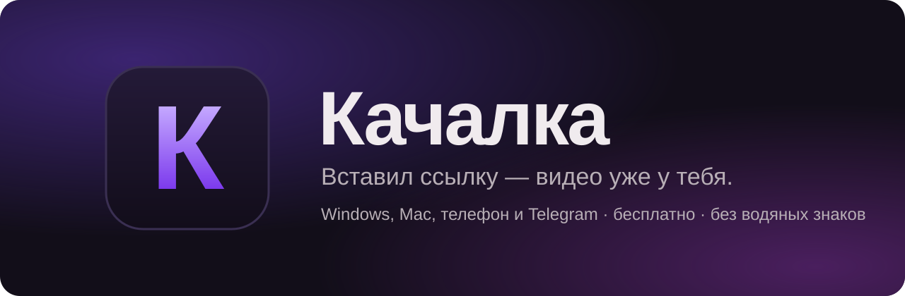
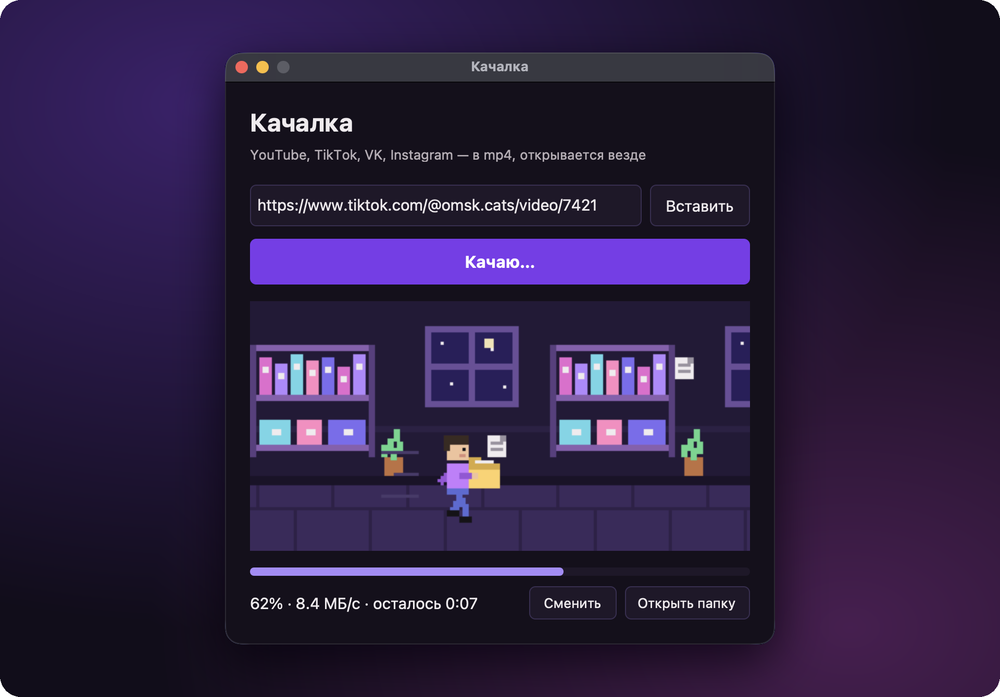
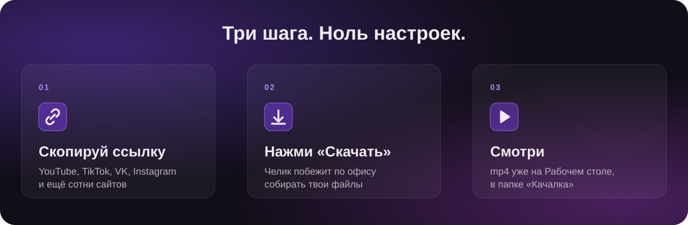
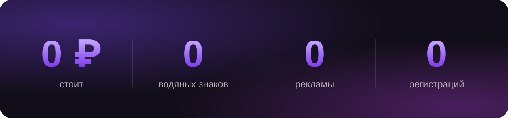
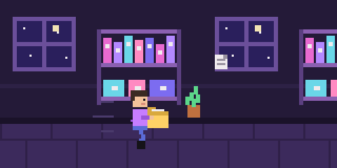
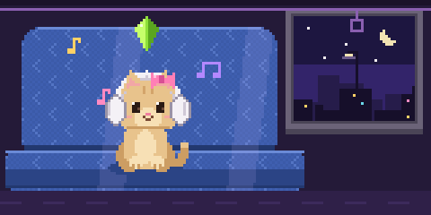
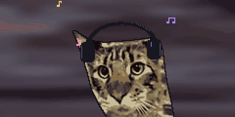

<p align="center">
  
</p>

<p align="center">
  <a href="https://github.com/kozliq/kachalka/releases/latest"></a>
  <a href="https://github.com/kozliq/kachalka/releases"></a>
  
  <a href="LICENSE"></a>
</p>

<h3 align="center">Вставил ссылку, нажал «Скачать» — видео уже на Рабочем столе.</h3>

<p align="center">
  YouTube, TikTok, VK, Instagram и сотни других сайтов. В 1080p, 720p, 480p или только звук в MP3 — как тебе удобнее. Без водяных знаков, рекламы и регистрации. Бесплатно навсегда.
</p>

<p align="center">
  <a href="https://github.com/kozliq/kachalka/releases/latest/download/Kachalka-Windows.exe"><b>⬇ Скачать для Windows</b></a>
  &nbsp;·&nbsp;
  <a href="https://github.com/kozliq/kachalka/releases/latest/download/Kachalka-Mac.zip"><b>⬇ Скачать для Mac</b></a>
  &nbsp;·&nbsp;
  <a href="https://kachalka.flownote.cc"><b>Сайт</b></a>
  &nbsp;·&nbsp;
  <a href="#установка">Установка</a>
  &nbsp;·&nbsp;
  <a href="#вопросы">Вопросы</a>
  &nbsp;·&nbsp;
  <a href="#поддержать">Поддержать</a>
</p>

<br>

<p align="center">
  
</p>

<br>

<p align="center">
  
</p>

<p align="center">
  
</p>

## Пока качается

Пока идёт загрузка, по офису бегает челик и складывает в папку твои файлы. Мелочь, а приятно.

<p align="center">
  
</p>

А если качаешь звук, в ночном автобусе едет котик в наушниках и качает головой в такт.

<p align="center">
  
</p>

А если трек дольше 2 минут, котика сменяет полосатый кот в чёрных наушниках — кивает в такт.

<p align="center">
  
</p>

## Установка

### Windows 10 и 11

1. Скачай **[Kachalka-Windows.exe](https://github.com/kozliq/kachalka/releases/latest/download/Kachalka-Windows.exe)** и запусти.
2. Если появится «Система Windows защитила ваш компьютер», нажми «Подробнее» → «Выполнить в любом случае». Так Windows встречает любую программу без платной подписи.

### Mac (M1 и новее)

1. Скачай **[Kachalka-Mac.zip](https://github.com/kozliq/kachalka/releases/latest/download/Kachalka-Mac.zip)**, распакуй и перетащи `Kachalka.app` в «Программы».
2. Один раз выполни в Терминале:
   ```bash
   xattr -dr com.apple.quarantine /Applications/Kachalka.app
   ```
   Программа не подписана платным сертификатом Apple, и команда снимает с неё пометку «скачано из интернета». Без Терминала тоже можно: открой Качалку, потом зайди в «Системные настройки» → «Конфиденциальность и безопасность» и нажми «Всё равно открыть».

Больше ничего ставить не нужно, всё нужное уже внутри. Папка «Качалка» на Рабочем столе появится сама при первом запуске.

## Вопросы

<details>
<summary><b>Правда бесплатно? Где подвох?</b></summary>
<br>
Подвоха нет. Программа работает на твоём компьютере, серверов у проекта нет, так что брать деньги не за что. Ни подписок, ни рекламы, ни «премиума». Если хочется сказать спасибо, есть <a href="DONATE.md">добровольная поддержка</a>, но она ни на что не влияет.
</details>

<details>
<summary><b>С каких сайтов качает?</b></summary>
<br>
YouTube, TikTok, VK, Instagram, X (Twitter), Rutube, Reddit, Twitch-клипы и сотни других: всё, что умеет <a href="https://github.com/yt-dlp/yt-dlp">yt-dlp</a>. Закрытые и платные видео не качает.
</details>

<details>
<summary><b>Точно без водяных знаков?</b></summary>
<br>
Качалка берёт видео прямо с сайта, без онлайн-скачивалок, поэтому никто не прилепит сверху свой логотип. TikTok тоже скачивается чистым.
</details>

<details>
<summary><b>В каком качестве и формате?</b></summary>
<br>
Выбираешь сам: 1080p, 720p или 480p. 720p и 480p весят в разы меньше, это удобно для Telegram. Видео всегда в H.264 и mp4, поэтому сразу открывается в QuickTime, на айфоне, в плеере Windows и отправляется в Telegram. 4K нет: YouTube отдаёт его только в формате, который многие плееры не открывают.

Нужен только звук — жми «MP3». Получишь mp3 320 kbps с названием, автором и обложкой: удобно для музыки, подкастов и битов.
</details>

<details>
<summary><b>Куда сохраняются видео?</b></summary>
<br>
На Рабочий стол, в папку «Качалка». Другую папку можно выбрать кнопкой «Сменить», программа её запомнит.
</details>

<details>
<summary><b>Пишет «нет связи с сайтом» или «сайт не отдал видео»</b></summary>
<br>
Значит, сайт заблокирован у твоего провайдера. Так часто бывает с YouTube и TikTok. Включи VPN для всего компьютера: VPN-расширение в браузере не подойдёт, потому что Качалка ходит в интернет сама, а не через браузер. Потом нажми «Скачать» ещё раз.
</details>

<details>
<summary><b>Перестало качать с какого-то сайта</b></summary>
<br>
Сайты иногда меняют устройство, и скачивалкам приходится догонять. Скачай свежую версию на странице <a href="https://github.com/kozliq/kachalka/releases/latest">Releases</a>. Если не помогло, <a href="https://github.com/kozliq/kachalka/issues/new">напиши</a>, с какой ссылкой проблема.
</details>

<details>
<summary><b>Безопасно ли это?</b></summary>
<br>
Код открыт целиком. Каждый релиз собирают серверы GitHub прямо из этого репозитория, и к нему прилагается подпись происхождения. Проверить её можно так:
<pre>gh attestation verify Kachalka-Windows.exe --owner kozliq</pre>
</details>

Качай только то, что тебе можно скачивать: свои видео, видео с разрешения автора, видео для личного просмотра.

## Поддержать

Качалка бесплатная и такой останется. Больше всего помогает ⭐ этому репозиторию и рассказ друзьям. А если хочется поблагодарить иначе, вот [страница поддержки](DONATE.md).

## Для разработчиков

```bash
pip install -r requirements.txt
python main.py          # запустить
python make_gif.py      # перерисовать челика
python build.py         # собрать exe / app в папку dist
```

Новая версия выходит так: ставишь тег `v1.0.1` и отправляешь его на GitHub, а сборка для Windows и Mac запускается сама.

## Благодарности

[yt-dlp](https://github.com/yt-dlp/yt-dlp) делает всю тяжёлую работу, [FFmpeg](https://ffmpeg.org) склеивает видео со звуком, [CustomTkinter](https://github.com/TomSchimansky/CustomTkinter) рисует окно.

Лицензия [MIT](LICENSE).
